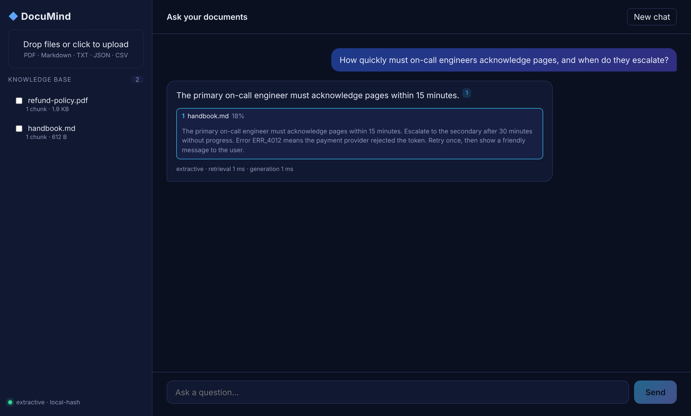
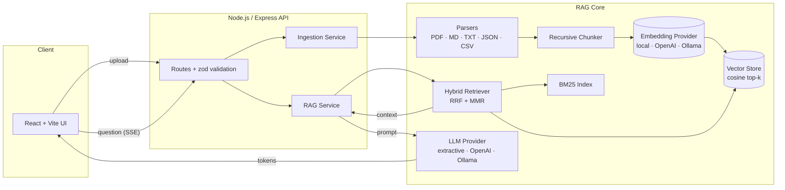

<div align="center">

# ◆ DocuMind

**Ask questions about your documents and get answers you can verify.**

A production-grade Retrieval-Augmented Generation (RAG) platform with hybrid search,
streaming responses and passage-level citations. It runs fully offline with zero API keys,
or plugs into OpenAI-compatible APIs and local Ollama models.

[](https://github.com/TheNameIsWin/documind/actions/workflows/ci.yml)




</div>

---

## Why DocuMind?

Most "chat with your PDF" demos paste the top-3 vector matches into a prompt and hope.
DocuMind treats retrieval as the hard part:

| Problem                                                    | How DocuMind handles it                                                        |
| ---------------------------------------------------------- | ------------------------------------------------------------------------------ |
| Vector search misses exact terms like `ERR_4012` or `v2.3` | **Hybrid retrieval**: dense vectors + BM25, merged with Reciprocal Rank Fusion |
| Top results are near-duplicates of each other              | **MMR re-ranking** trades relevance against redundancy                         |
| Users can't tell if the answer is made up                  | **Inline citations** with the exact matching passage for every claim           |
| Chunks cut sentences in half                               | **Recursive splitter** respects paragraphs → lines → sentences → words         |
| Switching embedding models silently corrupts the index     | Index is **stamped with its model**; mismatches are detected on boot           |
| Slow, all-at-once responses                                | **Server-Sent Events** stream tokens; generation aborts if the client leaves   |

## Features

- 📄 **Ingestion:** PDF, Markdown, TXT, JSON and CSV, with content-addressed IDs (re-uploads replace instead of duplicating)
- 🔎 **Hybrid search:** cosine similarity + Okapi BM25 → RRF → MMR
- 🧩 **Pluggable providers:** `local` / `openai` / `ollama` embeddings; `extractive` / `openai` / `ollama` generation
- 🔌 **Offline mode:** a hashing-trick embedder and an extractive answerer run the whole pipeline with no keys and no GPU
- ⚡ **Streaming API:** SSE with typed events (`citations` → `token`* → `done`) plus timing metrics
- 🛡️ **Production hygiene:** zod-validated config and requests, structured logs with request IDs, Helmet, CORS, rate limiting, graceful shutdown, crash-safe atomic persistence
- 🐳 **Ops-ready:** multi-stage Docker images (non-root, tini, healthchecks), Compose stack, GitHub Actions CI
- ✅ **Tested:** 50+ unit and integration tests covering chunking, retrieval quality, SSE streaming and API contracts

## Architecture



### Request lifecycle: `POST /api/chat`

1. **Validate** the body with zod (question, history, optional document filter).
2. **Embed** the question and run **dense** and **BM25** searches, each returning a candidate pool of 4 × top-k.
3. **Fuse** rankings with RRF (`1 / (60 + rank)`), discard weak semantic matches that have no keyword hit.
4. **Diversify** with MMR (λ = 0.7) and emit a `citations` event immediately, so the UI shows sources before the answer.
5. **Generate** with a grounded system prompt (cite every claim, treat context as data, never invent facts) and stream `token` events.
6. **Finish** with a `done` event carrying the full answer, model name, and retrieval/generation latency.

## Quick start

### Option 1: local dev (no API keys needed)

```bash
git clone https://github.com/TheNameIsWin/documind.git
cd documind
cp .env.example .env
npm install
npm run dev
```

Open **http://localhost:5173**, drop in a PDF, and ask a question.

### Option 2: Docker

```bash
docker compose up --build
# → http://localhost:3000
```

### Use a real model

**OpenAI (or any OpenAI-compatible API: Groq, Together, LM Studio, vLLM):**

```env
EMBEDDINGS_PROVIDER=openai
LLM_PROVIDER=openai
OPENAI_API_KEY=sk-...
# OPENAI_BASE_URL=https://api.groq.com/openai/v1
```

**Fully local with Ollama:**

```bash
docker compose --profile ollama up -d
docker compose exec ollama ollama pull llama3.1
docker compose exec ollama ollama pull nomic-embed-text
```

```env
EMBEDDINGS_PROVIDER=ollama
LLM_PROVIDER=ollama
```

> Changing the embedding provider changes the vector space. DocuMind detects this on boot and starts a fresh index rather than mixing incompatible vectors.

## API reference

| Method   | Endpoint              | Description                                               |
| -------- | --------------------- | --------------------------------------------------------- |
| `GET`    | `/health`             | Liveness probe                                            |
| `GET`    | `/ready`              | Readiness + active providers and document count           |
| `GET`    | `/api/documents`      | List indexed documents                                    |
| `POST`   | `/api/documents`      | Upload a file (`multipart/form-data`, field `file`)       |
| `POST`   | `/api/documents/text` | Index raw text `{ name, text }`                           |
| `GET`    | `/api/documents/:id`  | Document metadata + chunks with source offsets            |
| `DELETE` | `/api/documents/:id`  | Remove a document from the index                          |
| `POST`   | `/api/chat`           | Ask a question (SSE stream, or JSON with `stream: false`) |

<details>
<summary><b>Example: streaming chat</b></summary>

```bash
curl -N http://localhost:8080/api/chat \
  -H 'content-type: application/json' \
  -d '{"question": "What is our refund window?"}'
```

```text
event: citations
data: {"citations":[{"ref":1,"documentName":"refund-policy.pdf","score":0.61,"snippet":"Refund policy: customers can request a full refund within 30 days of purchase..."}]}

event: token
data: {"text":"Customers "}

event: token
data: {"text":"can request a full refund within 30 days [1]."}

event: done
data: {"answer":"Customers can request a full refund within 30 days [1].","usage":{"retrievalMs":4,"generationMs":812,"model":"openai:gpt-4o-mini"}}
```

</details>

<details>
<summary><b>Error format</b></summary>

Every error has the same shape and carries the request ID for log correlation:

```json
{
  "error": {
    "code": "BAD_REQUEST",
    "message": "Invalid request body",
    "details": [{ "path": "question", "message": "String must contain at least 1 character(s)" }],
    "requestId": "7f1c2a9e-..."
  }
}
```

</details>

## Configuration

All settings are validated at startup; the server refuses to boot with an invalid config.

| Variable              | Default      | Description                                   |
| --------------------- | ------------ | --------------------------------------------- |
| `EMBEDDINGS_PROVIDER` | `local`      | `local` · `openai` · `ollama`                 |
| `LLM_PROVIDER`        | `extractive` | `extractive` · `openai` · `ollama`            |
| `CHUNK_SIZE`          | `800`        | Max characters per chunk                      |
| `CHUNK_OVERLAP`       | `120`        | Characters of context carried between chunks  |
| `TOP_K`               | `5`          | Passages sent to the model                    |
| `MIN_SCORE`           | `0.15`       | Cosine floor (bypassed by exact keyword hits) |
| `MAX_UPLOAD_MB`       | `10`         | Upload size limit                             |
| `DATA_DIR`            | `./data`     | Where the index is persisted                  |

See [`.env.example`](.env.example) for the full list.

## Project structure

```text
documind/
├── apps/
│   ├── server/                 # Node.js + TypeScript API
│   │   ├── src/
│   │   │   ├── config/         # zod-validated environment
│   │   │   ├── core/
│   │   │   │   ├── ingestion/  # parsers, recursive chunker, ingestion service
│   │   │   │   ├── embeddings/ # local hashing model, OpenAI, Ollama
│   │   │   │   ├── vectorstore/# store interface + in-memory implementation
│   │   │   │   ├── rag/        # BM25, hybrid retriever, prompt, RAG service
│   │   │   │   └── llm/        # extractive, OpenAI, Ollama providers
│   │   │   ├── http/           # routes, validation, error handling
│   │   │   ├── app.ts          # Express app factory
│   │   │   └── container.ts    # composition root (dependency wiring)
│   │   └── test/               # vitest unit + integration tests
│   └── web/                    # React + Vite client
├── .github/workflows/ci.yml    # lint → typecheck → test → build → docker
└── docker-compose.yml
```

## Design decisions

- **Interfaces at every boundary.** `EmbeddingProvider`, `LlmProvider` and `VectorStore` are small interfaces wired in one composition root, so swapping in pgvector or Qdrant touches one file.
- **Exact search by default.** Brute-force cosine is O(n·d) and handles tens of thousands of chunks in milliseconds. An ANN index adds complexity that isn't needed until well past that.
- **RRF over score blending.** Cosine and BM25 scores live on different scales; rank-based fusion needs no tuning and is robust.
- **Citations first.** Sources are streamed before the answer so users can start verifying immediately, and the prompt forbids uncited claims.
- **Offline-first.** A deterministic local pipeline makes the test suite fast and hermetic, and the app usable without any vendor account.

## Development

```bash
npm run dev          # API on :8080, UI on :5173 (proxied)
npm test             # all tests
npm run lint         # ESLint
npm run typecheck    # tsc --noEmit
npm run format       # Prettier
```

## Roadmap

- [ ] pgvector / Qdrant `VectorStore` adapters
- [ ] Cross-encoder re-ranking stage
- [ ] Per-user workspaces with auth
- [ ] Evaluation harness (faithfulness, answer relevance, context recall)
- [ ] OCR for scanned PDFs

## License

[MIT](LICENSE) © TheNameIsWin
